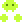
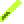
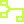
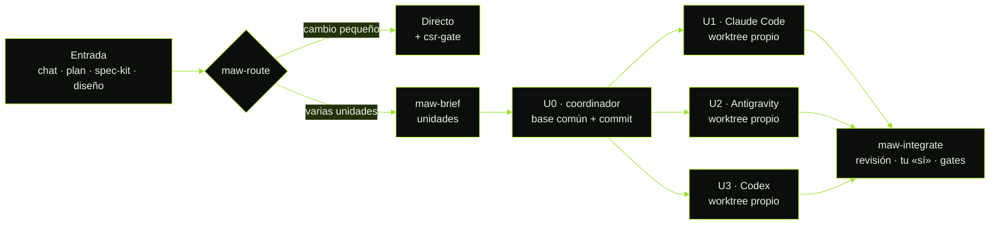
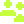
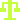

<div align="center">

<a href="https://fernandobaqueroo.github.io/orca-multiagent-kit/"></a>

<sub>Pulsa el banner para abrir la versión interactiva.</sub>

# Orca Multiagent Kit

**Una sola fuente de reglas y skills para todos tus agentes de programación.<br>Calidad profesional en cada tarea, y varios agentes trabajando en paralelo sin pisarse.**

[](https://github.com/FernandoBaqueroo/orca-multiagent-kit/releases/latest)
[](https://github.com/FernandoBaqueroo/orca-multiagent-kit/actions/workflows/ci.yml)
[](LICENSE)
[](https://github.com/FernandoBaqueroo/orca-multiagent-kit/releases)


[**Descargar ZIP**](https://github.com/FernandoBaqueroo/orca-multiagent-kit/releases/latest/download/orca-multiagent-kit.zip) · [Web interactiva](https://fernandobaqueroo.github.io/orca-multiagent-kit/) · [Guía visual](https://fernandobaqueroo.github.io/orca-multiagent-kit/guia.html) · [Manual](docs/MANUAL.md) · [Changelog](CHANGELOG.md)

</div>

```bash
npx github:FernandoBaqueroo/orca-multiagent-kit install
```

---

## Índice

- [Qué es](#que-es)
- [Instalar](#instalar)
- [Comandos `omk`](#comandos)
- [Agentes soportados](#agentes)
- [Skills](#skills)
- [Flujo de trabajo](#flujo)
- [Estructura del repositorio](#estructura)
- [Documentación](#documentacion)
- [Contribuir](#contribuir)
- [Autores](#autores)
- [Licencia](#licencia)

<a id="que-es"></a>
##  Qué es

**Orca Multiagent Kit** reúne en `~/.agents/` las reglas y skills de todos tus agentes de programación. Tiene dos partes:

| Parte | Qué aporta |
|:--|:--|
| **CSR — Claude Session Rules** | Código de calidad profesional, auditado en seguridad (OWASP Top 10 2025, ASVS 5.0, CWE Top 25) y con tests. Una puerta de validez en 8 fases y una tabla de gates al cerrar cada tarea. Respuestas mínimas: el agente gasta tokens en pensar, no en hablar. |
| **MAW — Multi-Agent Work** | Varios agentes a la vez sin pisarse. Cualquier entrada (chat, plan, spec-kit o diseño) se convierte en unidades de trabajo; cada unidad va a su worktree y a su rama; la integración se hace con revisión y tu confirmación. Funciona con [Orca](https://www.onorca.dev), con subagentes nativos o con worktrees a mano. |

| Sin el kit | Con el kit |
|:--|:--|
| Una copia de las reglas por agente, que acaban divergiendo | **Una fuente**: cada agente importa o enlaza `~/.agents` |
| Claude cargaba todas las reglas en **cada mensaje** | Reglas **bajo demanda**; solo un núcleo de ~80 líneas está siempre cargado |
| Un agente, una tarea cada vez | Varios agentes en paralelo, con coordinador, informes e integración segura |

<a id="instalar"></a>
##  Instalar

Cuatro formas. Todas instalan lo mismo, hacen backup de lo que tocan y se deshacen con `omk restore`.

**1. npx** (Node ≥ 18, sin instalar nada global)
```bash
npx github:FernandoBaqueroo/orca-multiagent-kit install --dry-run   # qué haría
npx github:FernandoBaqueroo/orca-multiagent-kit install
```

**2. npm global**: deja el comando `omk` disponible siempre
```bash
npm install -g github:FernandoBaqueroo/orca-multiagent-kit
omk install
```

**3. curl** (sin Node)
```bash
curl -fsSL https://raw.githubusercontent.com/FernandoBaqueroo/orca-multiagent-kit/main/scripts/get.sh | bash
```

**4. ZIP**
```bash
curl -LO https://github.com/FernandoBaqueroo/orca-multiagent-kit/releases/latest/download/orca-multiagent-kit.zip
unzip orca-multiagent-kit.zip && cd orca-multiagent-kit
./install.sh --dry-run && ./install.sh
```
Cada [release](https://github.com/FernandoBaqueroo/orca-multiagent-kit/releases) publica `orca-multiagent-kit-vX.Y.Z.zip` y `SHA256SUMS`. Para comprobar la integridad: `shasum -a 256 -c SHA256SUMS`.

Después, reinicia tus agentes y escribe en cada proyecto **«inicializa el proyecto»**. La skill `kit-init` detecta el stack leyendo el repo, crea `AGENTS.md`, `STACK.md` y `ORCHESTRATION.md`, y te hace como mucho 4 preguntas.

Requisitos: macOS, Linux, WSL o Git Bash, con bash ≥ 3.2.

<a id="comandos"></a>
##  Comandos `omk`

| Comando | Qué hace |
|:--|:--|
| `omk install [--agents a,b] [--dry-run]` | Instala o migra la fuente única para los agentes detectados |
| `omk init [ruta]` | Prepara un proyecto (por defecto, la carpeta actual) |
| `omk verify` | Comprueba enlaces, imports y que no queden copias divergentes |
| `omk adopt <carpeta-skill>` | Comparte una skill externa (p. ej. impeccable) con todos los agentes |
| `omk backups` | Lista las copias de seguridad |
| `omk restore <fecha>` | Deshace una instalación |
| `omk update` | Actualiza a la última versión y reinstala |
| `omk where` · `omk version` · `omk help` | Rutas, versión y ayuda |

Sin Node, cada comando tiene su equivalente en `./install.sh` (`--verify`, `--project`, `--adopt`, `--restore`, `--dry-run`).

<a id="agentes"></a>
##  Agentes soportados

| Agente | Reglas globales | Skills | Estado |
|:--|:--|:--|:--|
|  | `@~/.agents/AGENTS.md` importado en `~/.claude/CLAUDE.md` | enlaces en `~/.claude/skills` | soportado |
|  | `~/.gemini/GEMINI.md` → enlace | enlaces en `~/.gemini/config/skills` | soportado |
|  | `~/.codex/AGENTS.md` → enlace | nativo en `~/.agents/skills` | soportado |
|  | `~/.copilot/copilot-instructions.md` → enlace | nativo en `~/.agents/skills` | soportado |
|  | una línea en *Settings → Rules* (no usa ficheros) | nativo en `~/.agents/skills` | soportado |
|  | `~/.config/devin/AGENTS.md` → enlace | — | opcional (`--agents devin`) |

En cada proyecto, las reglas van en `AGENTS.md`, que leen todos los agentes. `CLAUDE.md` solo contiene `@AGENTS.md`.

<a id="skills"></a>
##  Skills

| Skill | Para qué | Pídelo así |
|:--|:--|:--|
| `kit-init` | Prepara o migra un proyecto: reglas, stack y orquestación | «inicializa el proyecto» |
| `csr-stack` | Genera `STACK.md` detectando lenguajes, comandos y riesgos | «genera el STACK.md» |
| `csr-gate` | Puerta de validez: format → lint → tipos → build → tests → cobertura → seguridad | «pasa los gates» |
| `csr-audit` | Auditoría de seguridad OWASP / ASVS / CWE | «audita la seguridad del diff» |
| `maw-route` | Elige modo (directo · plan · spec · carrera · diseño) y motor | automático |
| `maw-brief` | Convierte chat, plan, spec-kit o mockup en unidades de trabajo | «conviértelo en unidades» |
| `maw-plan` | Plan maestro por sprints, con aprobación humana o en paralelo | «planifica X en sprints» |
| `maw-dispatch` | Coordinador: U0, reparto y supervisión (Orca · subagentes · manual) | «reparte las user stories» |
| `maw-worker` | Contrato de cada worker e informe con formato fijo | automático |
| `maw-integrate` | Revisión, merge con tu «sí» y gates del conjunto | «integra la ronda» |
| `maw-race` | El mismo problema a 2–3 agentes; gana el mejor diff | «carrera entre Claude y Gemini» |
| `maw-setup` | `ORCHESTRATION.md`, `orca.yaml`, `.worktreeinclude` | «prepara la orquestación» |

Convive con skills externas como **impeccable**, **supabase**, **spec-kit** y las de **Orca**: cada una manda en su terreno, y la puerta de validez y las prohibiciones se aplican siempre.

<a id="flujo"></a>
##  Flujo de trabajo



**Las reglas que nunca se rompen:**
- Una unidad = un worktree = una rama.
- Los ficheros compartidos los toca una sola unidad por ronda.
- Los workers no editan `tasks.md`, planes ni `STACK.md`, y no hacen merge.
- Sin informe no hay unidad.
- Nunca `PASS` de algo no ejecutado.
- Lo pequeño no se orquesta.

Con **spec-kit**, las decisiones son tuyas (`specify → clarify → plan → tasks → analyze`). Setup + Foundational es la U0, cada user story es una unidad y el coordinador marca `[x]` al integrar.

<a id="estructura"></a>
##  Estructura del repositorio

```text
orca-multiagent-kit/
├── bin/omk.js              CLI omk (npm / npx), sin dependencias
├── core/AGENTS.md          núcleo siempre cargado (~80 líneas)
├── rules/                  00-router … 95-multi-agent  +  lang/ (17 lenguajes)
├── skills/                 kit-init · csr-* · maw-*
├── templates/              AGENTS.md · CLAUDE.md · STACK.md · ORCHESTRATION.md · orca.yaml · .worktreeinclude
├── output-styles/          csr-minimal (Claude Code)
├── install.sh              instala · migra · verifica · restaura · adopta
├── GUIA.html               guía visual del flujo
├── site/                   web interactiva (GitHub Pages)
├── docs/MANUAL.md          manual completo
├── AI_INSTALL.md           instrucciones para que una IA lo instale
├── tests/                  pruebas del instalador y del CLI en un $HOME desechable
├── scripts/                check.sh · build-release.sh · get.sh · banner.py
└── .github/                CI (Linux + macOS), releases con zip, web, plantillas de issues y PR
```

<a id="documentacion"></a>
##  Documentación

| Documento | Para quién |
|:--|:--|
| [Web interactiva](https://fernandobaqueroo.github.io/orca-multiagent-kit/) | Presentación, instalación y comandos |
| [Guía visual](https://fernandobaqueroo.github.io/orca-multiagent-kit/guia.html) ([`GUIA.html`](GUIA.html)) | El flujo de trabajo completo, con esquemas |
| [`docs/MANUAL.md`](docs/MANUAL.md) | Instalación detallada, migración, convivencia y problemas frecuentes |
| [`AI_INSTALL.md`](AI_INSTALL.md) | Una IA que tiene que instalar o integrar el kit |
| [`CHANGELOG.md`](CHANGELOG.md) | Historial de versiones ([SemVer](https://semver.org/lang/es/)) |

<a id="contribuir"></a>
##  Contribuir

Las contribuciones son bienvenidas. Lee [`CONTRIBUTING.md`](CONTRIBUTING.md): principios, cómo añadir skills o reglas, versionado y releases. Antes de abrir un PR:

```bash
npm test     # check.sh + pruebas del instalador + pruebas del CLI
```

[Código de conducta](CODE_OF_CONDUCT.md) · [Seguridad](SECURITY.md) · [Soporte](SUPPORT.md)

<a id="autores"></a>
##  Autores

<table>
  <tr>
    <td align="center" width="50%" valign="top">
      <a href="https://github.com/Necro-Coder"><br><b>Necro-Coder</b></a><br>
      <sub>Autor de <b>CSR — Claude Session Rules</b></sub>
      <p align="left"><sub>Diseñó la base de calidad del kit: el protocolo de respuesta de consumo mínimo, la carga progresiva de reglas, la puerta de validez en 8 fases, los módulos de clean code, seguridad (OWASP, ASVS, CWE), testing, rendimiento, fiabilidad y cadena de suministro, las 17 guías por lenguaje y las skills <code>csr-stack</code>, <code>csr-gate</code> y <code>csr-audit</code>.</sub></p>
    </td>
    <td align="center" width="50%" valign="top">
      <a href="https://github.com/FernandoBaqueroo"><br><b>Fernando Baquero</b></a><br>
      <sub>Autor de <b>Orca Multiagent Kit</b> y <b>MAW — Multi-Agent Work</b></sub>
      <p align="left"><sub>Convirtió CSR en una fuente única para varios proveedores (Claude Code, Antigravity, Codex, Copilot, Cursor y Devin). Creó la capa de orquestación multiagente (unidades de trabajo, worktrees, Orca y spec-kit), <code>kit-init</code>, el CLI <code>omk</code>, el instalador con migración, verificación y restauración, y la guía visual.</sub></p>
    </td>
  </tr>
</table>

<a id="licencia"></a>
##  Licencia

[MIT](LICENSE) © 2026 Fernando Baquero y Necro-Coder.

Las marcas Claude, Gemini/Antigravity, Codex/OpenAI, GitHub Copilot, Cursor y Orca pertenecen a sus respectivos propietarios. Se usan solo para indicar compatibilidad; este proyecto no está afiliado a ninguno de ellos.
